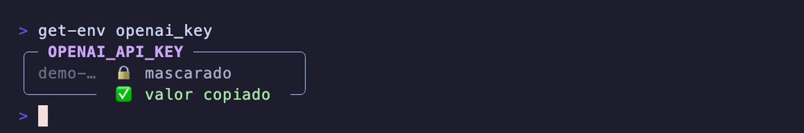
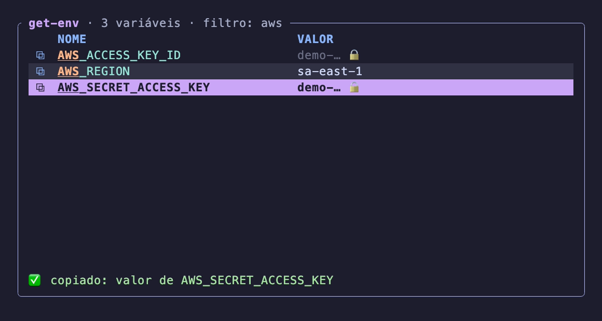

<h1 align="center">get-env</h1>

<p align="center">
  <strong>Acha a variável de ambiente que você quer pelo nome aproximado, mostra sem vazar o segredo e copia o valor.</strong>
</p>

<p align="center">
  <a href="LICENSE"></a>
  
  
</p>

<p align="center">
  
</p>

---

`echo $OPENAI_API_KEY` exige lembrar o nome exato e despeja o segredo inteiro na tela (e no histórico de quem está olhando). `env | grep -i openai` mostra tudo cru. O `get-env` resolve as duas coisas:

```console
$ get-env openai_key      # um resultado: cartão + valor no clipboard
$ get-env aws             # vários: tabela interativa, já filtrada
$ get-env                 # tudo, na tabela
```

## ✨ O que ele faz

- 🔎 **Busca aproximada, sem caixa.** `openai_key` ou só `oak` chegam em `OPENAI_API_KEY`.
- 📋 **Copia direto.** Com um resultado só, o valor real vai para o clipboard e um cartão confirma.
- 🔒 **Não vaza segredo na tela.** Nomes com `TOKEN`, `KEY`, `SECRET`, `PASS`, `CREDENTIAL`, `DATABASE_URL`, `JWT`, `DSN` ou a palavra `AUTH`, e valores com formato de credencial conhecida (as 217 regras do [gitleaks](https://github.com/gitleaks/gitleaks) que valem fora de arquivo, de AWS e GitHub a Stripe e chave PEM, mais URL com senha; ver [NOTICE](NOTICE)), aparecem mascarados (`demo-…`); o clipboard recebe o valor inteiro.
- ⏱️ **Clipboard que expira.** A cópia vai marcada como confidencial (`org.nspasteboard.ConcealedType`), para gerenciadores de clipboard não guardarem histórico, e é apagada em 60 s, só se ninguém copiou outra coisa nesse meio-tempo.
- 🖱️ **Tabela interativa.** Teclado e mouse, busca ao vivo com `/`, um clique no `⧉` copia a linha pronta para colar no shell.
- 🎨 **Cores que combinam com o sistema.** Catppuccin Mocha no tema escuro do macOS, Latte no claro, as 16 cores do terminal quando não dá para saber, nenhuma com `NO_COLOR`.
- 🧰 **Bom em pipe.** Fora de um terminal imprime `NOME=valor` mascarado, sem cor e sem copiar nada.
- 📄 **Lê arquivos `.env`.** `get-env -f .env db` procura só no arquivo.
- 🌐 **Fala o seu idioma.** Português ou inglês, conforme o locale e o idioma do macOS; `get-env --help` explica tudo.

<p align="center">
  
</p>

## 📦 Instalação

Precisa do Rust 1.85 ou mais novo (o crate usa a edition 2024).

```sh
cargo install --git https://github.com/gustavobittencourt/get-env
```

O binário vai para `~/.cargo/bin/get-env`.

## 🚀 Uso

```text
get-env [nome] [--file|-f <arquivo.env>] [--no-clear]
get-env -h|--help
```

| situação | o que acontece |
|---|---|
| **um** resultado, no terminal | mostra o cartão e copia o valor |
| **vários** resultados, ou sem `nome`, no terminal | abre a tabela, com o `nome` como filtro inicial |
| saída em pipe ou arquivo | imprime `NOME=valor`, uma por linha, com os segredos mascarados e sem copiar |
| `-f arquivo.env` | troca o ambiente pelas variáveis do arquivo |
| `--no-clear` | não apaga o clipboard depois da cópia |
| `-h` ou `--help` | mostra a ajuda colorida, em qualquer posição |

### Como a busca escolhe

Sem diferenciar maiúsculas de minúsculas, nesta ordem:

1. o nome **igual** ao que você digitou;
2. senão, os nomes que **contêm** o texto, em ordem alfabética;
3. senão, os nomes que têm as **letras na mesma ordem**, do trecho mais curto para o mais longo (`oak` → `OPENAI_API_KEY`).

### Na tabela

<p align="center">
  
</p>

| tecla ou gesto | ação |
|---|---|
| `↑` `↓`, `j` `k` ou rolagem | move a seleção |
| `⏎` ou clique no `⧉` | copia a linha `NOME='valor'`, com aspas só quando o shell precisa |
| `n` / duplo clique no nome | copia o nome |
| `v` / duplo clique no valor | copia o valor |
| `/` | busca ao vivo; `⏎` ou `↓` confirmam, `Esc` limpa |
| `?` | mostra estes atalhos; qualquer tecla fecha |
| `Esc` | limpa o filtro; sem filtro, sai |
| `q` ou `Ctrl-C` | sai |

Durante a busca, tudo o que você digita vai para o filtro: `j`, `k`, `n`, `v`, `q` e `?` só são atalhos fora dela.

### Máscara

| valor | aparece como |
|---|---|
| nome sem `TOKEN`/`KEY`/`SECRET`/`PASS` | inteiro |
| sensível, até 5 caracteres | `•••` |
| sensível, mais longo | os 5 primeiros + `…` |

Caracteres de controle (`\n`, `\t`, `ESC`…) aparecem escapados, então um valor malicioso não consegue mudar a cor nem o título do terminal.

### Códigos de saída

| código | quando |
|---|---|
| `0` | deu certo |
| `1` | nenhuma variável casou, o arquivo não abriu ou a cópia falhou |
| `2` | argumentos inválidos (`-h` e `--help` saem com `0`) |

## ⚙️ Configuração

| variável | efeito |
|---|---|
| `GET_ENV_LANG` | `pt` ou `en` forçam o idioma; sem ela, valem `LC_ALL`, `LC_MESSAGES`, `LANG` e o idioma do macOS, nessa ordem, com inglês como padrão |
| `GET_ENV_THEME` | `dark`, `light` ou `ansi` forçam a paleta; sem ela, vale o tema do macOS |
| `NO_COLOR` | qualquer valor não vazio desliga as cores ([no-color.org](https://no-color.org)) |
| `GET_ENV_CLIP_CLEAR` | segundos até apagar a cópia (padrão `60`); `0` desliga |
| `GET_ENV_CLIP_CMD` | comando que recebe a cópia no stdin, no lugar do pasteboard do macOS; sem marca de confidencial e sem limpeza automática |

A limpeza fica a cargo de um processo destacado (o próprio `get-env` num modo oculto, em sessão nova), que recebe só o prazo e o `changeCount` do pasteboard, nunca o valor. Ao fim do prazo ele apaga o clipboard só se o `changeCount` ainda é o da cópia; se você copiou outra coisa, nada muda. A conferência e a limpeza não são atômicas: uma cópia sua feita exatamente entre as duas chamadas seria apagada.

`GET_ENV_CLIP_CMD` permite usar o `get-env` fora do macOS, por exemplo com `wl-copy` ou `xclip -selection clipboard`. Isso não foi testado: o desenvolvimento e os testes são todos no macOS.

> [!WARNING]
> `-f` **executa** o arquivo com `source` num `zsh -f` separado, para que referências como `B=$A-x` resolvam como no shell. Use só com arquivos em que você confia.

## 🛠️ Desenvolvimento

```sh
cargo fmt --check
cargo clippy -- -D warnings
cargo test
```

Os testes rodam o binário com o ambiente zerado e só com variáveis falsas, e a cópia vai para um arquivo temporário via `GET_ENV_CLIP_CMD` ou para um pasteboard com nome próprio (`GET_ENV_PASTEBOARD`, só para testes). Nenhum teste lê o seu ambiente nem toca no seu clipboard.

A demo deste README é gravada com o [VHS](https://github.com/charmbracelet/vhs), também num ambiente só com valores falsos:

```sh
cargo build --release
assets/demo.sh
```

## 📄 Licença

[MIT](LICENSE) © 2026 Gustavo Bittencourt
